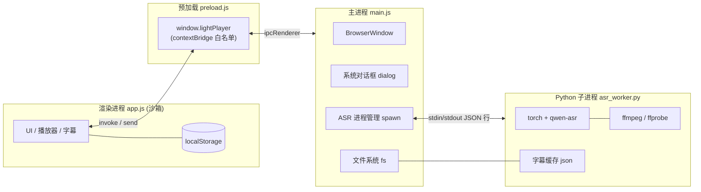
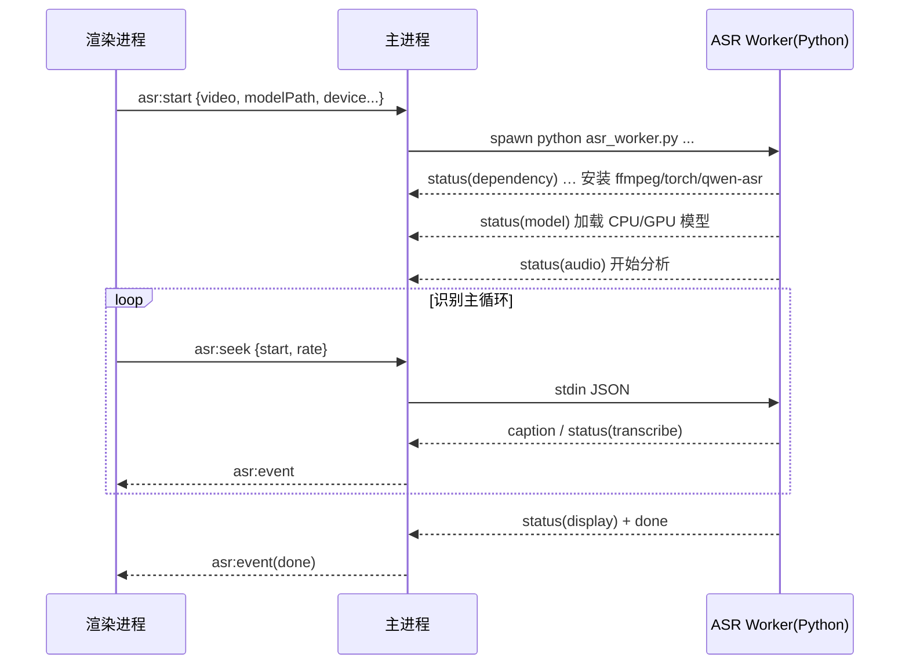

# LightPlayer Code Wiki

> 轻量、隐私优先的本地视频播放器，内置 **Qwen3-ASR 实时字幕**（本机识别，不上传视频）。
> 本文档面向开发者，覆盖：整体架构、模块职责、关键类与函数、依赖关系、IPC/数据协议、运行与打包方式。

---

## 目录

1. [项目概览](#1-项目概览)
2. [技术栈与依赖关系](#2-技术栈与依赖关系)
3. [整体架构](#3-整体架构)
4. [目录结构](#4-目录结构)
5. [模块职责详解](#5-模块职责详解)
6. [关键类与函数说明](#6-关键类与函数说明)
7. [IPC 与数据协议](#7-ipc-与数据协议)
8. [数据持久化](#8-数据持久化)
9. [核心流程](#9-核心流程)
10. [运行方式](#10-运行方式)
11. [打包与发布](#11-打包与发布)
12. [设计要点与注意事项](#12-设计要点与注意事项)

---

## 1. 项目概览

LightPlayer 是一个基于 **Electron** 的桌面端本地视频/音频播放器。除常规播放能力外，其核心特色是**实时字幕（ASR）**能力：

- 用户选定本地 **Qwen3-ASR** 模型目录后，播放器会围绕**当前播放头**动态识别音频并实时显示字幕。
- 所有识别均在**本机**完成，视频不会上传。
- 识别结果缓存在视频同目录（`<视频名>.lightplayer-subs.json`），下次打开直接复用，仅识别缺失部分。
- 支持 **GPU + CPU 混合推理**（自动检测 NVIDIA GPU / CUDA，缺失依赖可自动下载安装）。

| 项目属性 | 值 |
| --- | --- |
| 名称 / 版本 | `lightplayer` / `1.0.0` |
| 主入口 | `src/main.js`（Electron 主进程） |
| 运行时 | Electron `^33.2.1` |
| 打包工具 | electron-builder `^25.1.8` |
| 目标平台 | Windows（NSIS 安装包 + portable 免安装） |
| 许可证 | MIT |
| 界面语言 | 简体中文 |

### 功能特性

- 本地视频/音频播放（MP4、MKV、WebM、MOV、AVI、M4V、MP3、WAV、FLAC）
- 播放列表管理（按文件夹分组、可折叠、去重）
- 续播记忆（记住播放进度 / 播放列表，含"自动播放上次未播完内容"联动开关）
- 播放后操作（无操作 / 自动连播 / 循环播放）
- 倍速播放（0.5×–3×）、音量记忆、硬件加速开关
- 可配置快捷键（含录制替换、冲突解除、恢复默认）
- 外部字幕文件载入（SRT / VTT）、字幕样式自定义、SRT 导出
- Qwen3-ASR 实时字幕（CPU / GPU / 自动混合设备策略）
- 字幕缓存复用与数据管理（可清理进度 / 列表 / 设置 / 缓存）

---

## 2. 技术栈与依赖关系

### 2.1 Node.js / Electron 侧依赖

仅有两个开发期依赖（`package.json` → `devDependencies`）：

| 依赖 | 版本 | 用途 |
| --- | --- | --- |
| `electron` | `^33.2.1` | 桌面运行容器（主进程 / 渲染进程 / 预加载脚本） |
| `electron-builder` | `^25.1.8` | 打包为 Windows NSIS / portable |

运行时还使用 Electron 内置模块：`app`、`BrowserWindow`、`dialog`、`ipcMain`、`contextBridge`、`ipcRenderer`、`webUtils`；Node 内置模块：`path`、`fs`、`child_process`（`spawn` / `spawnSync`）。

### 2.2 Python（ASR Worker）侧依赖

`asr_worker.py` 运行在**独立 Python 进程**中，由主进程 `spawn` 启动。其依赖分两类：

**Python 标准库**（无需安装）：`argparse, importlib, json, os, re, shutil, subprocess, sys, tempfile, threading, time, types, urllib.request, zipfile, wave, array, math, queue, concurrent.futures`。

**第三方依赖（按需自动安装）**：

| 依赖 | 何时使用 | 安装方式 |
| --- | --- | --- |
| `qwen-asr` | Qwen3-ASR 后端 | `pip install`（多镜像回退） |
| `torch` | 模型推理 | CPU 版 `pip install torch`；GPU 版从 `download.pytorch.org/whl/cu121` 安装 CUDA 版 |
| `ffmpeg` / `ffprobe` | 音频抽取、时长读取 | 若 PATH 中找不到，自动从 `gyan.dev` 下载 Windows 构建并解压（存入 `%LOCALAPPDATA%\LightPlayer\runtime\ffmpeg`） |

> 环境变量（`asr_worker.py` 顶部设置）：`TRANSFORMERS_VERBOSITY=error`、`CUDA_MODULE_LOADING=LAZY`、`OMP_NUM_THREADS=1`、`MKL_NUM_THREADS=1`、`PYTORCH_JIT=0`、`TOKENIZERS_PARALLELISM=false`。

### 2.3 依赖关系图

```
LightPlayer
├── Electron 应用（Node/JS）
│   ├── src/main.js        ← 主进程：窗口、对话框、IPC、Python 进程管理
│   ├── src/preload.js     ← 预加载：contextBridge 暴露 window.lightPlayer
│   └── src/app.js         ← 渲染进程：UI / 播放 / 字幕 / 持久化
│       ├── src/index.html ← 页面骨架（CSP + 挂载点 #app）
│       └── src/styles.css ← 全部样式
└── Python ASR Worker（子进程）
    └── src/asr_worker.py  ← ffmpeg + torch + qwen-asr 推理，JSON 行协议
        ├── torch / qwen-asr（第三方，可自动安装）
        └── ffmpeg / ffprobe（第三方，可自动下载）
```

---

## 3. 整体架构

LightPlayer 遵循 Electron 经典的**三进程模型 + 一个外挂 Python 子进程**：

- **主进程（main）**：唯一拥有 Node 完整能力的进程，负责窗口、系统对话框、文件系统读写、以及 Python ASR 子进程的生命周期与消息转发。
- **渲染进程（renderer，`app.js`）**：运行在浏览器沙箱中（`contextIsolation: true`、`nodeIntegration: false`），负责全部 UI、`<video>` 播放、字幕渲染与本地设置存储。**不能直接访问 Node/文件系统**，一切系统能力通过 `window.lightPlayer` 走 IPC。
- **预加载脚本（preload）**：桥接层，用 `contextBridge.exposeInMainWorld` 暴露白名单 API。
- **ASR Worker（Python 子进程）**：独立进程，避免重负载（torch）阻塞 Electron。主进程与 Worker 通过 **stdio 上的 JSON 行协议**通信。

### 3.1 架构图



### 3.2 关键安全与启动配置

- `main.js` 在应用启动前设置 `autoplay-policy = no-user-gesture-required`，以支持"重启后自动续播"。
- 启动前读取硬件加速标记（`userData/hw-accel.json`）；关闭时调用 `app.disableHardwareAcceleration()`（GPU 开关必须在 app ready 前设置，且 localStorage 主进程不可访问，故用 marker 文件持久化）。
- `BrowserWindow` 使用 `frame: false`（自绘标题栏）、`contextIsolation: true`、`nodeIntegration: false`，预加载 `preload.js`。
- `index.html` 使用 CSP 限制资源来源：`default-src 'self' blob: data:; media-src 'self' blob: file:; style-src 'self' 'unsafe-inline'; script-src 'self'`。

---

## 4. 目录结构

```
LightPlayer/
├── package.json          # 元信息、脚本、electron-builder 打包配置
└── src/
    ├── main.js           # 主进程（189 行）：窗口/对话框/IPC/Python 进程
    ├── preload.js        # 预加载（22 行）：contextBridge API 暴露
    ├── app.js            # 渲染进程（959 行）：UI/播放/字幕/持久化
    ├── index.html        # 页面骨架（CSP + <div id="app"> + 引入 app.js）
    ├── styles.css        # 全部样式（CSS 变量主题、暗色 UI）
    └── asr_worker.py     # Python ASR Worker（821 行）：识别流水线
```

> 打包配置中 `asarUnpack: ["src/asr_worker.py"]` 确保 Python 脚本以真实文件存在（Python 无法读取 asar 内文件）。

---

## 5. 模块职责详解

### 5.1 `src/main.js`（主进程）

职责：

1. **启动配置**：自动播放策略、硬件加速开关。
2. **窗口管理**：创建无边框 `BrowserWindow`，最小化/最大化/关闭。
3. **系统对话框**：打开视频、打开文件夹（递归扫描支持的扩展名并按自然序排序）、打开字幕、选择模型目录、导出 SRT 保存对话框。
4. **文件系统能力**：会话落盘（`session.json`）、硬件加速 marker、字幕缓存读写/清除、SRT 导出写文件（带 UTF-8 BOM）。
5. **ASR 进程管理**：定位 worker 脚本、探测 Python、`spawn` 子进程、解析 stdout JSON 行并转发、转发 stderr、处理 `close`/`error`、处理 `seek`/`stop`。

关键设计：
- `resolveAsrWorker()`：开发模式直接用源码路径；打包模式优先 `app.asar.unpacked`，缺失则从 asar 复制到 `userData` 再执行。
- `findPython()`：Windows 依次尝试 `py -3.12 / -3.13 / -3.11 / -3 / python / python3`，探测 `--version` 并缓存结果。
- ASR 输出采用**逐行 JSON**：`buffer` 拆分 `\r?\n`，逐行 `JSON.parse` 后 `sender.send('asr:event', data)`。
- **进程替换防串流**：切换视频时先 `kill` 旧进程并置 `asrProcess = null`，旧进程后续的 stdout/close 因 `proc !== asrProcess` 被丢弃，避免旧视频字幕污染新视频。

### 5.2 `src/preload.js`（预加载桥接）

通过 `contextBridge.exposeInMainWorld('lightPlayer', {...})` 暴露白名单 API，全部为薄封装：

- `invoke` 类（请求-响应）：`openVideo`、`openVideoFolder`、`openSubtitle`、`openModelDirectory`、`readCaptionCache`、`clearCaptionCache`、`exportSrt`、`setHwAccel`、`getHwAccel`、`saveSession`、`loadSession`、`startAsr`。
- `send` 类（单向）：`stopAsr`、`seekAsr`、`minimize`、`maximize`、`close`。
- 事件订阅：`onAsrEvent(callback)` 订阅 `asr:event`。
- 工具：`pathForFile(file)` 使用 `webUtils.getPathForFile` 获取拖入文件的真实路径（回退 `file.path`）。

### 5.3 `src/app.js`（渲染进程）

单一 IIFE 式脚本，无框架。核心职责分区（文件内以注释分隔）：

- **图标与模板**：`ICONS` 统一 SVG 图标集（24px 网格、1.8 描边）；`app.innerHTML` 一次性写入全部页面结构（主界面 + 5 个弹窗）。
- **状态**：`subtitles`、`activeFile`、`playlist`、`expandedGroups`、`capStyle` 等。
- **持久化**：`store`（localStorage 包装）、`settings`、进度/列表保存。
- **播放控制**：播放/暂停、±10s、音量、静音、全屏、倍速、进度条、画面单击/双击。
- **播放列表**：文件夹分组、折叠、增删清空、连播。
- **字幕**：外部字幕解析（SRT/VTT）、样式应用、实时字幕 UI 与事件处理、SRT 导出。
- **实时字幕阶段 UI**：四阶段步骤条（依赖/模型/音频/转写）+ 进度条 + 设备徽章。
- **数据管理**：统计与清理 localStorage 数据。
- **快捷键**：动作注册表 + 可录制映射。
- **弹窗/菜单/拖放/窗口按钮**。

### 5.4 `src/asr_worker.py`（ASR Worker）

独立进程的识别流水线，职责：

1. **参数与环境**：解析命令行参数，处理设备策略（`auto`/`cpu`/`gpu`）。
2. **依赖准备**：确保 ffmpeg/ffprobe 存在；按需自动安装 `qwen-asr`、`torch`（CUDA 版可选）。
3. **GPU 检测与 CUDA 安装**：检测 NVIDIA 显卡、探测 torch CUDA 可用性、必要时安装 CUDA 版 torch。
4. **模型加载**：加载 Qwen3-ASR 模型（CPU float32 / GPU float16，可同时加载双模型）。
5. **缓存加载**：读取视频同目录缓存（v1/v2），下发已识别字幕并恢复已覆盖区间。
6. **识别主循环**：围绕播放头动态组批、按静音切分片段、批量推理、自适应批大小、写回字幕与缓存。
7. **stdin 命令**：`seek`（跳转优先识别当前位置）、`pos`（位置同步）。
8. **输出**：以 JSON 行 `emit(...)` 输出 `status` / `caption` / `captions` / `error` / `done` 等事件。

### 5.5 `src/index.html` 与 `src/styles.css`

- `index.html`：极简骨架——CSP、`<div id="app">`、引入 `styles.css` 与 `app.js`。
- `styles.css`：暗色主题（CSS 变量），覆盖标题栏、主菜单、弹窗、布局、控制条、倍速菜单、侧栏播放列表、字幕面板、ASR 进度、设置面板、滚动条等。字幕位置通过 `.cap-bottom/.cap-lower/.cap-center/.cap-top` 类与内联样式共同控制。

---

## 6. 关键类与函数说明

### 6.1 主进程 `main.js`

| 函数 | 说明 |
| --- | --- |
| `readHwAccel()` | 读取 `userData/hw-accel.json`，返回是否启用硬件加速（默认 `true`）。 |
| `resolveAsrWorker()` | 解析 `asr_worker.py` 的可执行路径（开发/打包/回退复制到 userData）。 |
| `findPython()` | 探测可用 Python 3 解释器，缓存并返回 `[命令, 前置参数]`。 |
| `createWindow()` | 创建 1440×900、无边框、预加载 `preload.js` 的窗口并加载 `index.html`。 |
| `ipcMain.handle('asr:start', …)` | 终止旧进程 → 定位 worker/Python → `spawn` → 转发 stdout(JSON)/stderr/close/error。 |
| `ipcMain.on('asr:seek', …)` | 将 `{cmd, start, rate}` 写入 Worker stdin。 |

**注册的 IPC 通道**见 [第 7 节](#7-ipc-与数据协议)。

### 6.2 渲染进程 `app.js`（按功能分组）

**工具 / 状态**

| 名称 | 说明 |
| --- | --- |
| `ICONS` / `icon(name)` | SVG 图标集与生成函数。 |
| `escapeHtml(s)` | HTML 转义，防止路径/文件名注入。 |
| `store.get/set/del` | localStorage 包装（前缀 `lightplayer-`，JSON 序列化，异常安全）。 |
| `settings` | `{ resumePlay, keepPlaylist }` 开关状态。 |

**会话持久化**

| 名称 | 说明 |
| --- | --- |
| `saveProgress()` / `loadProgress(file)` | 每 3s 保存播放进度；读取时忽略片头片尾 5s 内位置。 |
| `savePlaylistState()` | 保存 `{files, active}` 到 localStorage，并**双写**主进程 `session:save`（防快速关闭丢失）。 |

**字幕显示与样式**

| 名称 | 说明 |
| --- | --- |
| `displayCurrentCaption()` | 按当前时间查找命中字幕并显示；使用 `subsDirty` 延迟排序避免逐条排序。 |
| `applyCaptionStyle()` | 应用字号/颜色/背景/透明度/位置（预设或自定义 px/auto），并持久化。 |
| `DEFAULT_CAP_STYLE` / `capStyle` | 字幕样式默认值与当前值。 |
| `parseSub(raw)` | 解析 SRT/VTT 时间轴与文本。 |
| `toSrtTime(s)` | 秒 → `HH:MM:SS,mmm`。 |

**播放列表**

| 名称 | 说明 |
| --- | --- |
| `buildGroups()` | 按文件所在目录分组并按自然序排序。 |
| `renderPlaylist()` | 渲染分组树（当前播放目录自动展开，其余默认折叠）。 |
| `stopPlayback()` | 停止播放、清空当前文件与字幕、重置 ASR UI。 |
| `removeFile` / `removeGroup` / `clearPlaylist` | 列表增删。 |

**文件载入**

| 名称 | 说明 |
| --- | --- |
| `fileUrl(f)` | 路径 → `file://` URL（Windows 反斜杠规范化、`: → /C:`、URL 编码）。 |
| `loadFile(file, opts)` | 载入视频：重置 ASR、设置 `src`、续播定位、自动播放（含自动播放被拦截时的静音回退）、读取字幕缓存、按需重启识别。 |
| `openFiles` / `openFolder` | 调系统对话框并加入播放列表。 |
| `showResumeToast(seconds)` | 左下角续播提示（5s 倒计时条）。 |

**控制与设置**

| 名称 | 说明 |
| --- | --- |
| `renderSpeedMenu()` / 倍速绑定 | 0.5–3× 子菜单，选择后同步 ASR 位置。 |
| `afterPlay()` / `syncVideoLoop()` | 播放后操作：`none` / `next` / `loop`。 |
| `bindSettingSwitch(id,key,get,set)` | 通用开关绑定 + 持久化。 |
| `syncDependentSwitches()` | "自动续播"开启时锁定"记住进度/列表"为开。 |

**实时字幕**

| 名称 | 说明 |
| --- | --- |
| `setStepState` / `setDeviceBadge` / `updateAsrProgress` / `setAsrUi` | 阶段步骤条 / 设备徽章 / 进度 / 开关 UI 状态。 |
| `startAsrRun()` | 校验文件与模型路径、等待视频元数据、调用 `startAsr`。 |
| `toggleAsr()` | 开/关实时字幕（CC 按钮与面板开关共用）。 |
| `window.lightPlayer.onAsrEvent(...)` | 处理 `status/captions/caption/error/done/exit` 事件。 |
| `syncAsrPosition()` | 每 2.5s 及 seek/倍速变化时同步播放位置给 Worker。 |

**弹窗 / 数据管理 / 快捷键**

| 名称 | 说明 |
| --- | --- |
| `openModal` / `closeModals` / `switchModalTab` | 5 个弹窗的开关与标签切换。 |
| `refreshDataInfo` / `refreshCacheInfo` | 统计 localStorage 数据与当前视频字幕缓存。 |
| `clearProgressData` / `clearSettingsKeys` | 清理进度 / 设置（保留模型路径与进度、列表）。 |
| `HOTKEY_ACTIONS` / `hotkeyMap` / `renderHotkeyList` | 快捷键动作注册表、可录制映射与列表渲染。 |

### 6.3 ASR Worker `asr_worker.py`

**事件输出与状态**

| 名称 | 说明 |
| --- | --- |
| `emit(kind, **data)` | 输出一行 JSON 事件（`ensure_ascii=False`，`flush=True`）。 |
| `class AsrState` | 线程安全的共享状态：`pending_seek`、`playhead=(位置, 倍速, 时间戳)`。 |
| `stdin_reader(state)` | 后台线程逐行读取 `seek`/`pos` 命令并更新状态。 |

**区间（覆盖）管理** —— 保证"识别过的音频不重复识别"

| 名称 | 说明 |
| --- | --- |
| `mark_completed(intervals, start, end)` | 记录并合并相邻已转写区间。 |
| `next_uncovered(intervals, pos)` | 返回 ≥ pos 且未覆盖的最早位置。 |
| `coverage_seconds(intervals)` | 已覆盖总秒数（用于进度百分比）。 |
| `covered_limit(intervals, pos)` | pos 之后最近的已覆盖区间起点。 |

**音频处理**

| 名称 | 说明 |
| --- | --- |
| `load_pcm(path)` | 读取 16-bit PCM WAV。 |
| `frame_rms(samples, rate, frame_ms=20)` | 按 20ms 帧计算 RMS 能量。 |
| `snap_to_silence(path, target_s, min_s, max_s)` | 在目标时长附近找**静音中点**作为切片边界，避免拦腰截断句子。 |
| `slice_wav(path, out_path, seconds)` | 截取探测 WAV 前 N 秒（避免二次调用 ffmpeg）。 |
| `duration(path, ffmpeg_hint=None)` | 用 ffprobe 读取媒体时长。 |
| `ensure_ffmpeg()` | 定位 ffmpeg，Windows 缺失时自动下载解压到 `%LOCALAPPDATA%\LightPlayer\runtime\ffmpeg`。 |
| `extract(ffmpeg, source, target, start, seconds)` | 抽取 16kHz 单声道 PCM 音频片段。 |

**依赖安装**

| 名称 | 说明 |
| --- | --- |
| `run_pip_with_progress(cmd, label, …)` | 运行 pip 并解析百分比映射到进度；空闲超时切换源。 |
| `install_packages(packages)` | 多镜像（清华/阿里/中科大/官方）回退安装 torch / qwen-asr。 |
| `detect_nvidia_gpu()` | 通过 `nvidia-smi` / WMI / PowerShell CIM 检测 NVIDIA GPU 型号。 |
| `torch_cuda_ok()` | 子进程探测 torch 是否支持 CUDA（避免污染本进程导入状态）。 |
| `install_cuda_torch(gpu_name)` | 安装 CUDA 版 torch（`cu121`）；须在 import torch 之前调用。 |
| `prepare_cuda_environment(device_pref)` | 依赖阶段的 GPU/CUDA 检查与安装，返回 `(gpu_name, cuda_ready)`。 |

**模型加载**

| 名称 | 说明 |
| --- | --- |
| `load_qwen_backend()` | 以模块注入方式加载 `qwen_asr.inference.qwen3_asr.Qwen3ASRModel`（绕过缺失的 forced-aligner 依赖）。 |
| `import_with_heartbeat(importer, name)` | 带心跳进度上报的导入（每 2s 上报耗时）。 |
| `load_with_heartbeat(loader, hardware)` | 带心跳进度上报的模型加载。 |

**主流程与推理**

| 名称 | 说明 |
| --- | --- |
| `main()` | 参数解析 → 依赖/GPU 准备 → 模型加载 → 缓存加载 → 识别主循环 → 保存缓存 → `done`。 |
| `_run_model(model, paths)` | 兼容不同 `transcribe` 签名，批量或逐条转写。 |
| `transcribe_paths(paths)` | GPU+CPU 双模型时用 `ThreadPoolExecutor` 并行分担；任一侧失败只重试失败部分。 |
| `save_cache(force=False)` | 写入字幕缓存（节流 10s，`force` 用于关键节点）；含 `captions` 与 `covered`。 |

**媒体类型定义（缓存）**

```jsonc
// <video>.lightplayer-subs.json  v2
{
  "version": 2,
  "captions": [ { "start": 0.0, "end": 4.0, "text": "…" } ],
  "covered":  [ [0.0, 4.0] ]   // 覆盖区间（含无语音静音段，避免重复识别）
}
```

---

## 7. IPC 与数据协议

### 7.1 渲染进程 ↔ 主进程（ipcRenderer / ipcMain）

| 通道 | 类型 | 方向 | 载荷 / 返回 |
| --- | --- | --- | --- |
| `dialog:open-video` | invoke | R→M | 返回选中视频路径数组 |
| `dialog:open-video-folder` | invoke | R→M | 返回递归扫描到的媒体文件（自然序） |
| `dialog:open-subtitle` | invoke | R→M | 返回 `{ path, content }` |
| `dialog:open-model-directory` | invoke | R→M | 返回模型目录 |
| `captions:read-cache` | invoke | R→M | 入参视频路径，返回字幕数组或 `null`（兼容 v1/v2） |
| `captions:clear-cache` | invoke | R→M | 删除缓存文件 |
| `captions:export-srt` | invoke | R→M | 入参 `{video, srt}`，返回 `{ok, path}` 或 `{ok:false,message}` |
| `settings:hw-accel` | invoke | R→M | 写/读硬件加速 marker |
| `session:save` / `session:load` | invoke | R→M | 会话落盘 / 读取 `session.json` |
| `asr:start` | invoke | R→M | 入参 `{video, modelPath, modelKind, duration, start, device}` |
| `asr:stop` | send | R→M | 终止 Python 进程 |
| `asr:seek` | send | R→M | 入参 `{start, rate, seek?}` |
| `window:minimize` / `window:maximize` / `window:close` | send | R→M | 窗口控制 |
| `asr:event` | send | M→R | Worker 事件转发（见下） |

### 7.2 主进程 ↔ ASR Worker（stdio JSON 行协议）

**主进程 → Worker（stdin，每行一个 JSON）**

```jsonc
{ "cmd": "seek", "start": 12.5, "rate": 1.0 }   // 用户跳转：优先识别该位置
{ "cmd": "pos",  "start": 13.0, "rate": 1.0 }   // 常规位置同步
```

**Worker → 主进程（stdout，每行一个 JSON，统一含 `kind`）**

| kind | 关键字段 | 含义 |
| --- | --- | --- |
| `status` | `stage`(dependency/model/audio/transcribe/display), `message`, `percent`, `device?` | 阶段与进度 |
| `caption` | `start`, `end`, `text` | 单条实时字幕 |
| `captions` | `items:[{start,end,text}]` | 批量字幕（缓存恢复，一次性下发） |
| `error` | `message` | 错误 |
| `done` | — | 全部识别完成 |
| `exit` | `code`, `detail` | 进程退出（由主进程在 close 时下发） |

> Worker 的 `stderr` 会以 `{kind:'log', message}` 转发给渲染进程。

### 7.3 渲染进程处理 `asr:event`（`onAsrEvent`）

- `status` → 更新进度条、阶段步骤、设备徽章与消息。
- `captions` → 批量入列（`subsDirty=true`，显示时统一排序）。
- `caption` → 去重入库（剔除时间重叠的旧 ASR 字幕）并刷新显示。
- `error` → 记录 `asrLastError`，显示错误。
- `done` → 全部步骤置完成，进度 100%。
- `exit`（`code!==0` 且非已知错误）→ 提示检查模型路径与 Python 依赖。

---

## 8. 数据持久化

### 8.1 localStorage（键前缀 `lightplayer-`，存于渲染进程）

| 键 | 内容 |
| --- | --- |
| `lightplayer-volume` | `{ v, m }` 音量与静音 |
| `lightplayer-speed` | 播放倍速 |
| `lightplayer-playlist` | `{ files:[...], active }` 播放列表与当前文件 |
| `lightplayer-progress-<file>` | `{ t, d }` 单文件播放进度 |
| `lightplayer-resume-play` | 记住播放进度开关 |
| `lightplayer-keep-playlist` | 记住播放列表开关 |
| `lightplayer-auto-resume` | 自动播放上次未播完内容（开启时锁定上述两开关） |
| `lightplayer-after-play` | 播放后操作 `none/next/loop` |
| `lightplayer-hw-accel` | 硬件加速开关 |
| `lightplayer-hotkeys` | 快捷键映射 `{ actionId: 'Key' 或 'Ctrl+Key' }` |
| `lightplayer-hotkeys`(开关) / `lightplayer-device` | 快捷键启用、识别设备 |
| `lightplayer-caption-style` | 字幕样式对象 |
| `lightplayer-model-path` | 本地模型目录（清理设置时保留） |

### 8.2 主进程落盘文件（`app.getPath('userData')`）

| 文件 | 内容 |
| --- | --- |
| `session.json` | 会话（播放列表）同步落盘，防 localStorage 异步丢失 |
| `hw-accel.json` | `{ enabled }` 硬件加速 marker |

### 8.3 视频同目录缓存

| 文件 | 内容 |
| --- | --- |
| `<视频名>.lightplayer-subs.json` | 字幕缓存（v1 数组 / v2 `{version, captions, covered}`） |

> 清除字幕或"清除当前视频字幕缓存"会删除该文件。

---

## 9. 核心流程

### 9.1 应用启动与会话恢复

1. 主进程读取 `hw-accel.json` 决定是否启用硬件加速 → 创建窗口。
2. 渲染进程恢复音量、倍速。
3. 若"记住播放列表"开启：优先读主进程 `session.json`，回退 localStorage，恢复列表与上次视频（"自动续播"开启时自动播放并续播定位）。

### 9.2 打开/切换视频

1. 对话框或拖放得到路径 → 去重加入播放列表。
2. `loadFile()`：停止在跑的 ASR → 重置 ASR UI → 设置 `video.src` → 显示信息。
3. `loadedmetadata`：续播定位 + 自动播放（被策略拦截时静音回退，1.5s 后恢复音量）。
4. 读取字幕缓存并显示。
5. 若切换前 ASR 处于开启状态 → 自动为新视频重启识别。

### 9.3 实时字幕流水线



识别主循环要点：

- 依据**播放头 + 倍速 + 时间戳**预测当前应识别位置（`desired`）。
- **追赶式调度**：落后超过 `behind` 跳回播放头附近；领先超过 `ahead` 回头补空洞。
- **组批**：围绕播放头组装 `batch_size` 段，`lead` 秒窗口保证首批字幕尽快到达。
- **静音切分**：对较长片段用能量 VAD 在静音中点切分；过短空洞直接标记覆盖。
- **自适应批大小**：根据识别速度 EMA 在 2–6 之间调整（吞吐不足加大批量，富余则减小以降延迟）。
- **GPU+CPU 并行**：双模型时用两线程分担同批片段；GPU 异常则摘除并回退纯 CPU，且只补算失败部分。
- **缓存节流**：成功批次后按 10s 节流写缓存，收尾 `force=True`。

### 9.4 设备策略

- `auto`：检测到 CUDA GPU 时同时加载 CPU + GPU 模型并**混合识别**；否则 CPU。
- `gpu`：仅 GPU；不可用时回退 CPU。
- `cpu`：仅 CPU，并设置 `CUDA_VISIBLE_DEVICES=""`。

---

## 10. 运行方式

### 10.1 环境要求

- Node.js（用于运行 electron / electron-builder）。
- Python 3.10+（Windows 建议安装官方安装器并勾选 `py` 启动器）——仅使用实时字幕时需要。
- 首次使用实时字幕前，需在"字幕 → 实时字幕"中选择**本地 Qwen3-ASR 模型目录**。
- ffmpeg：可托管给程序自动下载；也可自行安装并加入 PATH。

### 10.2 安装与启动

```bash
# 进入项目目录
cd d:\AIWorkSpace\LightPlayer

# 安装依赖
npm install

# 启动（等价于 electron .）
npm start
# 或
npm run dev
```

### 10.3 常见脚本（package.json）

| 脚本 | 命令 | 说明 |
| --- | --- | --- |
| `start` | `electron .` | 启动应用 |
| `dev` | `electron .` | 启动应用（同 start） |
| `dist:win` | `electron-builder --win nsis portable` | 打包 Windows 安装包 + 免安装版 |
| `dist` | `electron-builder` | 按配置打包 |

---

## 11. 打包与发布

`package.json` → `build` 字段：

| 项 | 值 |
| --- | --- |
| `appId` / `productName` | `com.lightplayer.desktop` / `LightPlayer` |
| `directories.output` | `dist` |
| `files` | `src/**/*`、`package.json` |
| `asarUnpack` | `src/asr_worker.py`（确保 Python 脚本可被外部解释器读取） |
| `win.icon` | `build/icon.png` |
| `win.target` | `nsis` + `portable` |
| `win.artifactName` | `LightPlayer-${version}-${arch}.${ext}` |
| `win.signAndEditExecutable` | `false` |
| `nsis` | 非一键安装、允许更改安装目录、创建桌面快捷方式 |
| `portable.artifactName` | `LightPlayer-${version}-portable.${ext}` |

> 打包模式下，主进程会在 `app.asar.unpacked` 中查找 `asr_worker.py`；若缺失则从 asar 内复制到 `userData` 再执行（Python 无法读取 asar 内文件）。

---

## 12. 设计要点与注意事项

1. **安全边界**：渲染进程完全沙箱化（`contextIsolation`、无 `nodeIntegration`），仅通过 `window.lightPlayer` 白名单访问系统能力；页面配置 CSP 限制资源来源。
2. **自动播放策略**：主进程放宽 `autoplay-policy` 以支持自动续播；渲染侧仍处理"非静音播放被拒"的静音回退。
3. **数据落盘双保险**：`localStorage`（渲染） + `session.json`（主进程同步写），并在 `beforeunload` 与关闭按钮处强制保存——解决"快速关闭导致 localStorage 异步提交丢失、重启不恢复视频"的问题。
4. **ASR 进程隔离与换源防串流**：切换视频时先 `kill` 旧进程并置空引用，旧进程残留输出被丢弃；`asrProcess` 为单例，保证同一时刻只有一个 Worker。
5. **断点续识别**：`covered` 覆盖区间（含静音段）确保任何识别过的音频不重复处理，缓存命中时仅识别缺失部分。
6. **围绕播放头识别**：面向"实时观看"场景，优先识别贴近播放头的内容，seek 时从未覆盖区域继续。
7. **依赖自举**：ffmpeg 自动下载、pip 多镜像回退、CUDA 版 torch 按需安装，降低用户环境门槛；所有阶段通过 `status` 事件可视化。
8. **GPU 检测的进程隔离**：`torch_cuda_ok()` 用子进程探测，避免在当前进程中 import torch 后再覆盖安装导致的不安全问题。
9. **字幕排序优化**：批量插入时用 `subsDirty` 延迟到显示前统一排序，避免逐条插入的 O(n²) 卡顿。
10. **模型路径保护**：清理设置时保留 `lightplayer-model-path`（重新选择成本高）。

---

*本文档基于仓库当前源码（LightPlayer v1.0.0）整理；若源码变更，请同步更新对应章节。*