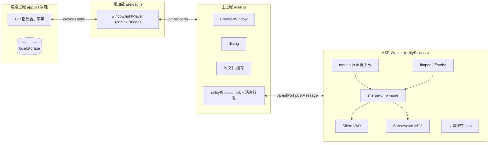
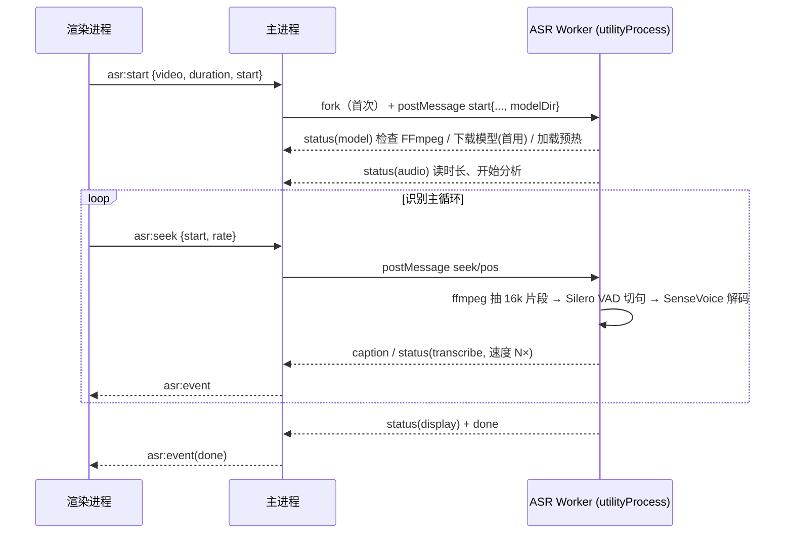

# LightPlayer Code Wiki

> 轻量、隐私优先的本地视频播放器，内置 **SenseVoice 实时字幕**（sherpa-onnx / ONNX Runtime，纯 CPU 本机识别，不上传视频，免安装、无需 Python 与独立显卡）。
> 本文档面向开发者，覆盖：整体架构、模块职责、关键类与函数、依赖关系、IPC/数据协议、模型下载、运行与打包方式。

---

## 目录

1. [项目概览](#1-项目概览)
2. [技术栈与依赖关系](#2-技术栈与依赖关系)
3. [整体架构](#3-整体架构)
4. [目录结构](#4-目录结构)
5. [模块职责详解](#5-模块职责详解)
6. [关键类与函数说明](#6-关键类与函数说明)
7. [IPC 与数据协议](#7-ipc-与数据协议)
8. [数据持久化](#8-数据持久化)
9. [模型与 FFmpeg 下载](#9-模型与-ffmpeg-下载)
10. [核心流程](#10-核心流程)
11. [运行方式](#11-运行方式)
12. [打包与发布](#12-打包与发布)
13. [设计要点与踩坑记录](#13-设计要点与踩坑记录)

---

## 1. 项目概览

LightPlayer 是一个基于 **Electron** 的桌面端本地视频/音频播放器。核心特色是**实时字幕（ASR）**：

- 开启字幕后，播放器围绕**当前播放头**动态识别音频并实时显示字幕。
- 识别在**本机**完成：内置 ONNX Runtime + 量化小模型，**不需要 Python、不需要独立显卡/GPU**，普通 CPU 即可实时（实测约 7–15× 播放速度）。
- 识别引擎为 **SenseVoiceSmall INT8**（中/英/粤/日/韩多语种，CTC 非自回归）+ **Silero VAD**（神经语音活动检测、静音切分）。
- 模型与 FFmpeg 在首次使用时通过**公开仓库 URL 直链**按需下载（无需自建服务器），缓存到本机；之后完全离线可用。
- 识别结果缓存在视频同目录（`<视频名>.lightplayer-subs.json`），下次打开直接复用，仅识别缺失部分。

| 项目属性 | 值 |
| --- | --- |
| 名称 / 版本 | `lightplayer` / `1.0.0` |
| 主入口 | `src/main.js`（Electron 主进程） |
| 运行时 | Electron `^33.2.1`（Chromium 130 / Node 20） |
| ASR 引擎 | `sherpa-onnx-node` `^1.13.8`（绑定 `sherpa-onnx-win-x64`，内置 onnxruntime 1.28） |
| 打包工具 | electron-builder `^25.1.8` |
| 目标平台 / 产物 | Windows x64 / portable 免安装 zip |
| 许可证 | MIT |
| 界面语言 | 简体中文 |

### 功能特性

- 本地视频/音频播放（MP4、MKV、WebM、MOV、AVI、M4V、MP3、WAV、FLAC）
- **关闭到托盘**（设置 → 通用，默认开启）：点标题栏 × 只最小化到系统托盘，播放状态保留；托盘右键菜单「显示LightPlayer / 打开视频… / 关闭视频 / 退出LightPlayer」，左键单击托盘图标唤回窗口
- **单实例**：软件已打开时再次点击快捷方式/exe，不新开进程，直接把已打开窗口还原并置顶
- 播放画面交互：单击画面播放/暂停（延迟 250ms 等双击判定）、双击切换全屏；**暂停时画面中心显示半透明圆角矩形播放图标（白底 + 白三角），点击图标或画面任意处都能继续播放**（普通与全屏一致，空状态下不显示）
- 播放列表管理（按文件夹分组、可折叠、去重）
- 续播记忆（进度 / 播放列表）；「自动开播」（默认关）决定载入后是否起播，「自动定位上次观看位置」（默认开）决定是否跳到上次进度
- 播放后操作（无操作 / 自动连播 / 循环播放）；播放设置通过右侧工具组齿轮按钮弹出**浮层**（与字幕/音量/倍速同组同风格），左上角菜单「设置」仍打开完整设置弹窗，两处控件共享同一份状态
- 倍速播放（0.5×–3×）、音量记忆（音量按钮位于右侧工具组最左，点击在按钮正上方居中弹出**竖向**滑条子菜单并显示百分比；**窗口前台聚焦时在播放区滚动鼠标滚轮即可调节音量**，并弹出居中音量提示 toast，普通与全屏一致）、硬件加速开关
- 可配置快捷键（录制替换、冲突解除、恢复默认）
- 外部字幕载入（SRT / VTT / ASS / SSA / TXT）、字幕样式自定义、SRT 导出
- SenseVoice 实时字幕（中/英/粤/日/韩，纯 CPU，首用自动下载约 240MB 模型）
- 字幕缓存复用与数据管理（缓存读写在实时字幕弹窗顶部「是否使用缓存」开关控制，默认关闭；可清理进度 / 列表 / 设置 / 缓存）

---

## 2. 技术栈与依赖关系

### 2.1 npm 依赖（`package.json`）

| 依赖 | 类型 | 版本 | 用途 |
| --- | --- | --- | --- |
| `electron` | devDependencies | `^33.2.1` | 桌面运行容器（主进程 / 渲染进程 / utilityProcess） |
| `electron-builder` | devDependencies | `^25.1.8` | 打包为 Windows portable zip |
| `sherpa-onnx-node` | **dependencies** | `^1.13.8` | k2-fsa 官方 Node 绑定，封装 SenseVoice / Silero VAD / readWave 等 API |
| `sherpa-onnx-win-x64` | 可选依赖（随绑定自动安装） | `^1.13.8` | Windows x64 预编译原生模块：`sherpa-onnx.node` + `onnxruntime.dll` + `sherpa-onnx-c-api.dll` |

> 历史版本曾依赖用户自装 Python + PyTorch（CUDA 包约 2.6GB）。现已**完全移除 Python 链路**，改用随包分发的原生 ONNX Runtime（约 22MB），无任何运行期安装步骤。

Electron 内置模块：`app`、`BrowserWindow`、`dialog`、`ipcMain`、`Menu`、`Tray`、`nativeImage`、`contextBridge`、`ipcRenderer`、`webUtils`、`utilityProcess`；Node 内置模块：`path`、`fs`、`os`、`https`、`http`、`child_process`（`spawn` / `spawnSync`）。

### 2.2 外部运行时（按需自动下载，非 npm）

| 组件 | 用途 | 存放位置 |
| --- | --- | --- |
| SenseVoice INT8 模型 + tokens + Silero VAD（共约 240MB） | 语音识别 / 静音切分 | `%LOCALAPPDATA%\LightPlayer\models\sensevoice-2024-07-17\` |
| ffmpeg / ffprobe（缺失时） | 音频抽取、时长读取 | `%LOCALAPPDATA%\LightPlayer\runtime\ffmpeg\bin\`（PATH 中存在则直接复用） |

### 2.3 依赖关系图

```
LightPlayer（Electron 应用）
├── 主进程 src/main.js
│   ├── 窗口 / 对话框 / IPC / 文件系统
│   └── utilityProcess.fork ──→ ASR Worker（独立 Node 子进程）
│                                ├── src/asr/asr_worker.js  识别流水线（常驻）
│                                ├── src/asr/models.js      模型/FFmpeg 直链下载
│                                └── sherpa-onnx-node
│                                    └── sherpa-onnx-win-x64（onnxruntime.dll 原生）
├── 预加载 src/preload.js（contextBridge → window.lightPlayer）
└── 渲染进程 src/app.js（UI / 播放 / 字幕 / localStorage）
    ├── src/index.html
    └── src/styles.css
```

---

## 3. 整体架构

Electron **三进程模型**，其中 ASR 跑在 Electron 官方的 `utilityProcess`（轻量 Node 子进程，无渲染环境、可加载原生模块）：

- **主进程（main，`main.js`）**：窗口、系统对话框、文件读写、ASR worker 的生命周期与消息转发。
- **渲染进程（renderer，`app.js`）**：浏览器沙箱（`contextIsolation: true`、`nodeIntegration: false`），全部 UI、`<video>` 播放、字幕渲染、localStorage。系统能力一律经 `window.lightPlayer` 走 IPC。
- **预加载脚本（preload，`preload.js`）**：`contextBridge.exposeInMainWorld` 白名单桥接。
- **ASR Worker（utilityProcess，`asr_worker.js`）**：常驻进程，模型只加载一次；负责下载模型、ffmpeg 抽音、VAD 切分、SenseVoice 推理、字幕缓存。与主进程通过 **MessagePort（`postMessage`）** 通信，而非 stdio。

### 3.1 架构图



### 3.2 关键启动与安全配置

- 启动前 `app.commandLine.appendSwitch('autoplay-policy', 'no-user-gesture-required')`，支持重启后自动续播。
- 启动前读 `userData/hw-accel.json`，关闭时 `app.disableHardwareAcceleration()`（Chromium GPU 开关必须在 ready 前设置）。
- `BrowserWindow`：`frame: false`（自绘标题栏）、`contextIsolation: true`、`nodeIntegration: false`、预加载 `preload.js`。
- CSP：`default-src 'self' blob: data:; media-src 'self' blob: file:; style-src 'self' 'unsafe-inline'; script-src 'self'`。

---

## 4. 目录结构

```
LightPlayer/
├── package.json            # 元信息、脚本、electron-builder 配置
├── CodeWiki.md             # 本文档
├── build/
│   ├── icon.ico            # Windows 应用图标
│   ├── icon.png            # 界面内图标（标题栏左上角 / 关于弹窗引用）
│   ├── tray.png            # 系统托盘图标（32px 圆形，由 icon.png 生成）
│   └── after-build.js      # electron-builder 收尾钩子：构建后删除中间产物
└── src/
    ├── main.js             # 主进程（286 行）：窗口/对话框/IPC/ASR worker 管理
    ├── preload.js          # 预加载（22 行）：contextBridge API
    ├── app.js              # 渲染进程（1373 行）：UI/播放/字幕/持久化
    ├── index.html          # 页面骨架（CSP + #app）
    ├── styles.css          # 全部样式（329 行，暗色主题）
    └── asr/
        ├── models.js       # 模型/FFmpeg 清单与 URL 直链下载器（401 行）
        └── asr_worker.js   # ASR 常驻 worker（496 行）：VAD + 推理 + 调度 + 缓存
```

> 开发期可在项目根放置 `models-dev/`（含 `model.int8.onnx`、`tokens.txt`、`silero_vad.onnx`），`resolveModelDir()` 会优先使用它，避免开发时重复下载；该目录在 `.gitignore` 中，不打包、不入库。

---

## 5. 模块职责详解

### 5.1 `src/main.js`（主进程）

1. **启动配置**：单实例锁（`requestSingleInstanceLock`，失败即 `app.quit()`）、自动播放策略、硬件加速 marker、Windows AppUserModelID（`com.lightplayer.desktop`）。
2. **窗口管理**：无边框窗口、最小化/最大化/关闭、关闭到托盘（close 事件拦截）。
3. **托盘**：`build/tray.png` 常驻托盘、右键菜单（显示 / 打开视频 / 关闭视频 / 退出）、左键单击唤回窗口。
4. **系统对话框**：打开视频、打开文件夹（递归扫描扩展名并自然序排序）、打开字幕、SRT 保存。
5. **文件系统能力**：`session.json` 落盘、硬件加速与关闭到托盘 marker、字幕缓存读取/清除（清除前先优雅停止识别会话）、SRT 导出（UTF-8 BOM）。
6. **ASR worker 管理**：`utilityProcess.fork` 常驻 worker；转发 worker 消息为 `asr:event`；管理会话 id、等待会话结束、退出时清理。

关键设计：

- **单实例**：`app.requestSingleInstanceLock()` 在文件顶部执行；第二个进程立即退出，第一个进程在 `second-instance` 里调 `revealMainWindow()`（还原最小化 → show → focus），因此不会新开窗口。
- **关闭到托盘**：`mainWindow.on('close')` 中若 `!appQuitting && closeToTrayOn` 则 `e.preventDefault()` + `win.hide()`，保持静默（不弹系统通知、不弹托盘气泡，用户明确要求无打扰）。`appQuitting` 只由托盘「退出」`{ appQuitting = true; app.quit(); }` 和 `before-quit` 置位。状态存 `userData/close-to-tray.json`（与 `hw-accel.json` 同一套 marker 机制，因为读 localStorage 的主进程拿不到渲染端设置），不带参数调用 `settings:close-to-tray` 即读取。
- **托盘生命周期**：`createTray()` 仅在 `closeToTrayOn` 为真时创建；开关关闭时 `tray.destroy()` 并置 `null`，不再驻留。
- `resolveAsrWorker()`：开发模式返回 `src/asr/asr_worker.js`；打包模式返回 `app.asar.unpacked/src/asr/asr_worker.js`（worker 与原生模块都在 asarUnpack 中）。
- `ensureAsrDaemon(sender)`：懒启动唯一常驻 worker，`stdio: ['ignore','ignore','pipe']`（stderr 用于错误诊断）；监听 `proc.on('message')` 与 `proc.on('exit')`。
- **会话串行化**：每次 `asr:start` 携带自增 `sid`，渲染端据此丢弃旧会话残留事件；停止/切换只影响当前 sid。
- `asr:start` 时由主进程用 `resolveModelDir(app.isPackaged, app.getAppPath(), process.resourcesPath)` 解析模型目录并随消息下发（utilityProcess 内没有 `app` 对象，无法自行解析）。
- 退出：先发 `{cmd:'shutdown'}`，700ms 后 `taskkill /T` 兜底带走 ffmpeg 孙进程。

### 5.2 `src/preload.js`（预加载桥接）

`contextBridge.exposeInMainWorld('lightPlayer', {...})`，全部为薄封装：

- `invoke`：`openVideo`、`openVideoFolder`、`openSubtitle`、`readCaptionCache`、`clearCaptionCache`、`clearAllCaptionCaches`、`exportSrt`、`setHwAccel`、`getHwAccel`、`setCloseToTray`、`getCloseToTray`、`saveSession`、`loadSession`、`startAsr`。
- `send`：`stopAsr`、`seekAsr`、`minimize`、`maximize`、`close`。
- 事件订阅：`onAsrEvent(callback)`、`onTrayAction(callback)`（收到 `'open-video'` / `'close-video'`）。
- 工具：`pathForFile(file)`（`webUtils.getPathForFile`，回退 `file.path`）。

> 已移除的旧 API：`openModelDirectory`、`startGpuSetup`、`cancelGpuSetup`、`onGpuSetupEvent`。

### 5.3 `src/app.js`（渲染进程）

无框架单文件脚本，以注释分区：

- **图标与模板**：`ICONS` SVG 图标集（标题栏左上角与「关于」不使用 SVG，而是引用 `build/icon.png` 真实图标）；一次性写入主界面与各弹窗（实时字幕 / 字幕样式 / 设置 / 数据管理 / 快捷键 / 关于 / 二次确认）。
- **状态 / 持久化**：`store`（localStorage 包装）、`settings`、进度与列表保存。
- **播放控制 / 播放列表 / 倍速 / 全屏 / 拖放**。
- **字幕**：外部字幕解析、样式、实时字幕事件处理、SRT 导出。
- **实时字幕阶段 UI**：三阶段步骤条（**准备识别模型 → 分析视频音频 → 实时转写**）+ 进度条 + 引擎徽章（固定显示“SenseVoice · CPU”）。
- **数据管理 / 快捷键 / 弹窗 / 自绘窗口按钮**。
- **托盘动作**：`window.lightPlayer.onTrayAction(action => …)` —— `'open-video'` 调 `openFiles()`，`'close-video'` 先 `saveProgress()`/`savePlaylistState()` 再 `stopPlayback()`（等同「关闭视频」回到空状态）。

设置弹窗分两栏：**通用**（`#closeToTray`，默认开启）在最前，其后是**播放设置**。关闭到托盘走 `setCloseToTray()`：写 localStorage + `setCloseToTray` IPC 即时通知主进程，启动时再以主进程返回值（marker 为准）校正 UI。

实时字幕相关 UI 状态：`asrSid`（当前会话 id）、`STAGES=['model','audio','transcribe']`、`STAGE_LABELS`、`setDeviceBadge`、`updateAsrProgress`、`setAsrUi`、`startAsrRun`、`toggleAsr`、`turnAsrOff`。

### 5.4 `src/asr/models.js`（模型与 FFmpeg 下载管理）

纯 https URL 直链下载器（不依赖 pip / npm / git / 任何安装器）。职责：

- 声明模型清单 `MODEL_FILES`（文件名 + 精确字节数 + 多个直链源）与版本目录 `MODEL_VERSION`。
- `resolveModelDir(...)`：按优先级解析模型目录（环境变量 → 随包内置 → 开发目录 `models-dev` → `%LOCALAPPDATA%` 下载目录）。
- `ensureModels(dir, onEvent, signal)`：校验完整性，缺文件则多源故障转移下载，带断点续传与进度事件。
- `ensureFfmpeg(onEvent)`：优先复用 PATH，否则从公开静态构建直链下载 zip，用系统 `tar` 解压并取出 ffmpeg/ffprobe。
- 详细下载源与策略见[第 9 节](#9-模型与-ffmpeg-下载)。

### 5.5 `src/asr/asr_worker.js`（ASR 常驻 worker）

运行于 utilityProcess，职责：

1. **引擎准备** `ensureEngine()`：FFmpeg 检查 → 模型下载/校验 → 构造 `OfflineRecognizer`（SenseVoice）与 `Vad`（Silero）→ 空音频预热。
2. **VAD 分段** `vadSegments()`：按 512 样本窗口喂入 Silero，输出语音段（自动跳过静音）。
3. **切片识别** `recognizeWav()`：对 16kHz wav 做 VAD，逐语音段 SenseVoice 解码并拼接文本；无语音返回 `null`。
4. **静音切分** `snapToSilence()`：在探测窗口的静音中点切片，避免拦腰截断句子。
5. **转写主循环** `transcribeVideoSession()`：围绕播放头追赶式调度、组批、自适应批大小、缓存加载/写入（移植自旧 Python 实现，业务语义保持一致）。
6. **命令处理**：`parentPort` 接收 `start/stop/seek/pos/shutdown`；事件经 `process.parentPort.postMessage` 回发。

### 5.6 `index.html` 与 `styles.css`

- `index.html`：CSP、`#app` 挂载点、引入样式与脚本。
- `styles.css`：CSS 变量暗色主题，覆盖标题栏、菜单、弹窗、控制条、侧栏列表、字幕面板、ASR 进度（三态步骤条）、设置面板等。

---

## 6. 关键类与函数说明

### 6.1 主进程 `main.js`

| 函数 | 说明 |
| --- | --- |
| `readHwAccel()` | 读 `userData/hw-accel.json`，默认启用硬件加速。 |
| `readCloseToTray()` / `writeCloseToTray(enabled)` | 读写 `userData/close-to-tray.json`（默认开启）。写入时同步 `closeToTrayOn`；关闭时销毁托盘。 |
| `createWindow()` | 创建无边框窗口；`close` 事件在 `!appQuitting && closeToTrayOn` 时 `preventDefault()` + `hide()`（保持静默，不弹通知）；`closed` 时清空 `mainWindow`。 |
| `revealMainWindow()` | 从托盘 / 二次启动唤回：`restore()` → `show()` → `focus()`；窗口已销毁则新建。 |
| `createTray()` / `trayMenu()` / `sendToRenderer(action)` | 托盘图标与右键菜单（显示LightPlayer / 打开视频… / 关闭视频 / 退出LightPlayer）；菜单动作转 `tray:action` 发给渲染端。隐藏到托盘保持静默，不弹通知。 |
| `resolveAsrWorker()` | 返回 worker 路径（开发源码 / 打包后的 app.asar.unpacked）。 |
| `killProcessTree(proc)` | Windows 下 `taskkill /F /T` 结束进程树（带走 ffmpeg 孙进程）。 |
| `ensureAsrDaemon(sender)` | 懒启动唯一常驻 utilityProcess，绑定 message/exit 转发。 |
| `asrSend(obj)` | `asrProcess.postMessage(obj)`。 |
| `asrStopSession()` / `waitSidSettled(sid)` | 停止当前会话并等待其落盘（清缓存前调用，9s 超时兜底）。 |
| `shutdownAsrDaemon()` | 发 shutdown，超时强杀进程树。 |
| `ipcMain.handle('asr:start')` | fork（如需）→ 分配 sid → 下发 `{cmd:'start', video, modelDir, duration, start, chunk}`。 |

### 6.2 渲染进程 `app.js`（分组摘录）

| 名称 | 说明 |
| --- | --- |
| `store.get/set/del` | localStorage 包装（前缀 `lightplayer-`，JSON，异常安全）。 |
| `saveProgress/loadProgress` | 进度记忆（3s 节流；读取忽略片头片尾 5s）。 |
| `savePlaylistState()` | 列表双写 localStorage + 主进程 `session:save`。 |
| `displayCurrentCaption()` | 按时间命中字幕显示；`subsDirty` 延迟排序。 |
| `parseSub/toSrtTime` | 外部字幕解析、SRT 时间格式化。 |
| `applyCaptionStyle/captionScale/syncCaptionFontSize` | 字幕样式应用；字号按播放区高度相对基准 `CAPTION_REF_H=800` 缩放（夹在 0.5–2.5），`ResizeObserver` 监听 `#videoWrap`，保证小窗口与全屏下字幕视觉大小一致。 |
| `positionFloatingPopover(pop, anchor, align)` | 统一弹窗定位：默认右缘对齐按钮右缘，`align='center'` 时相对按钮水平居中（音量弹窗）；优先显示在按钮上方，空间不足转下方，并夹在视口内。 |
| `wheelVolume(deltaY)` / `showVolumeToast()` / `hideVolumeToast()` | 滚轮调音量：一格 5%（`VOL_WHEEL_STEP`），复用 `setVolume()`（自动取消静音 + 持久化）；`showVolumeToast()` 刷新 `#volToast` 的百分比/进度条/图标（0% 显示静音图标）并重置 1.4s（`VOL_TOAST_MS`）隐藏计时；`hideVolumeToast()` 在 `stopPlayback()` 中调用。 |
| `toggleMute()` | 静音切换：`video.muted` 取反 → `syncVolumeUi()` → 持久化 → 复用 `showVolumeToast()` 提示（静音 0% + 静音图标）→ `fsShowUi()`。快捷键 `mute`（默认 `KeyM`）直接调用它，**不能**再走 `$('#mute').click()`。 |
| `togglePlaySettingsPopover(anchor)` | 工具栏齿轮按钮的播放设置浮层：开关逻辑与字幕菜单一致（`wasHidden` 先取再 `hideAllPopovers()`，再点按钮即收起）；打开前 `syncPlaySettingsUi()` 刷新控件。点击外部关闭必须走**捕获阶段**监听并放行 `#playSettingsBtn/#playPop` 内部点击（同坑 15）；`ResizeObserver` 在高度变化后按锚点重定位。 |
| `syncPlaySettingsUi()` / `reloadPlaySettings()` | 播放设置双 UI 同步：弹层（`pop*` 前缀 id）与设置弹窗各有一套控件，改值一律走 setter（`setAfterPlay/setResumePlay/...`）落盘后由 `syncPlaySettingsUi()` 按状态刷新两处，**不读 DOM 类名**避免漂移；`reloadPlaySettings()` 在「数据管理」清空设置后把内存 `settings/hwAccelOn` 重新按默认值读回并同步，防止清空后 UI 仍显示旧值。 |
| `buildGroups/renderPlaylist/loadFile/fileUrl` | 列表分组渲染、文件载入、`file:///` URL 构造、自动播放静音回退。 |
| `setPlayIcon()` | 同步主工具栏 `#play` / 全屏 `#fsPlay` 图标，并按 `video.paused && activeFile` 显隐画面中心播放图标 `#centerPlay`（`onplay`/`onpause`/载入/停止均调用）。`#centerPlay` 的 `onclick` 只做 `video.play()` 并 `stopPropagation()`，避免冒泡到 `#videoWrap` 的单击切换后又立刻暂停；同时记下 `centerPlayGuardAt`，让双击的第二下（此时图标已隐藏、落点在画面上）不误触全屏。 |
| `setCloseToTray(on)` / `syncCloseToTrayUi()` | 通用设置「关闭到托盘」：写 localStorage + `setCloseToTray` IPC（主进程即时生效），启动时 `getCloseToTray()` 以 marker 校正 UI。 |
| `startAsrRun/toggleAsr/turnAsrOff` | 启动（等元数据→`startAsr`）、开关、关闭复位。 |
| `updateAsrProgress/setStepState/setDeviceBadge/setAsrUi` | 阶段/进度/徽章/开关 UI。 |
| `onAsrEvent` | 处理 `status/captions/caption/stopped/error/done/exit`，按 sid 过滤。 |
| `syncAsrPosition` | 每 2.5s 与 seek/暂停时把 `{start,rate,seek?}` 同步给 worker。 |

### 6.3 worker `asr_worker.js`

| 名称 | 说明 |
| --- | --- |
| `emit(obj)` | `process.parentPort.postMessage`（无 sid 的进程级事件）。 |
| `class SessionControl` | 单会话控制柄：`sid/alive/stopping/abort/pendingSeek/playhead`；`shouldStop()`、`requestStop()`、`kill()`、`emit()`（会话级，失效后静默并自动带 sid）。 |
| `markCompleted/nextUncovered/coverageSeconds/coveredLimit` | 已覆盖区间的合并与查询（含静音段，保证不重复识别）。 |
| `extract/probeDuration/runProcess` | ffmpeg 抽取 16k 单声道 PCM、ffprobe 读时长。 |
| `ensureEngine(control, modelDir)` | 准备 FFmpeg + 模型，构造并预热识别器/VAD。 |
| `vadSegments(samples, reset)` | Silero VAD 分段（必须 512 样本/窗口喂入）。 |
| `recognizeWav(wavPath)` | VAD 去静音 → 逐段 SenseVoice 解码 → 拼接。 |
| `snapToSilence(wavPath,...)` | 探测窗口内基于 VAD 静音区间找切片边界。 |
| `transcribeVideoSession(cfg, ff, control)` | 主循环：缓存恢复、追赶调度、组批、自适应批量、写缓存。 |
| `saveCache(force)` | 原子写 v2 缓存（`.tmp` + rename，10s 节流）。 |

### 6.4 下载器 `models.js`

| 名称 | 说明 |
| --- | --- |
| `MODEL_VERSION` / `MODEL_FILES` | 版本目录名与文件清单（名称、字节数、URL 列表）。 |
| `resolveModelDir(isPackaged, appPath, resourcesPath)` | 模型目录解析（环境变量/内置/开发目录/下载目录）。 |
| `modelsReady(dir)` | 三个文件字节数全部匹配才算就绪。 |
| `requestUrl(url, opts)` | https.get 封装：浏览器 UA、自动跟随重定向（≤8 次）、socket 30s 超时、非 2xx 立即失败。 |
| `downloadOne(url, dest, size, onProgress, signal)` | 单文件下载：Range 断点续传（`.part`）、206 追加/200 重下、字节校验、近 5s 滑动测速。 |
| `downloadFile(file, dir, ...)` | 多源顺序故障转移，聚合并抛出每个源的错误。 |
| `ensureModels(dir, onEvent, signal)` | 整体模型准备（0–100% 进度）。 |
| `ensureFfmpeg(onEvent)` / `ffmpegSources()` / `downloadToFile()` | FFmpeg 多源下载与 `tar` 解压。 |

---

## 7. IPC 与数据协议

### 7.1 渲染进程 ↔ 主进程

| 通道 | 类型 | 载荷 / 返回 |
| --- | --- | --- |
| `dialog:open-video` / `dialog:open-video-folder` / `dialog:open-subtitle` | invoke | 文件/文件夹/字幕选择 |
| `captions:read-cache` | invoke | 入参视频路径，返回字幕数组或 `null`（兼容 v1/v2） |
| `captions:clear-cache` / `captions:clear-all-caches` | invoke | 删除缓存（先停识别会话） |
| `captions:export-srt` | invoke | `{video, srt}` → `{ok, path}` / `{ok:false,message}` |
| `settings:hw-accel` | invoke | 读/写硬件加速 marker |
| `settings:close-to-tray` | invoke | 带 `boolean` 即写入关闭到托盘 marker 并即时生效（关→销毁托盘，开→创建托盘）；不带参数返回当前值 |
| `session:save` / `session:load` | invoke | 播放列表会话落盘/读取 |
| `asr:start` | invoke | 入参 `{video, duration, start, chunk?}`；返回 `{ok, sid}`。**modelDir 由主进程解析，渲染端不再传模型路径/设备** |
| `asr:stop` | send | 停止当前会话（常驻 worker 与模型保留） |
| `asr:seek` | send | `{start, rate, seek?}` |
| `window:minimize/maximize/close` | send | 窗口控制（关闭到托盘开启时 `window:close` 只隐藏窗口且不销毁 ASR worker） |
| `asr:event` | send（M→R） | worker 事件转发 |
| `tray:action` | send（M→R） | 托盘菜单动作，载荷为 `'open-video'` / `'close-video'` |

### 7.2 主进程 ↔ ASR Worker（utilityProcess MessagePort）

> 不再是 stdio JSON 行，而是 `postMessage`。worker 收到的是 **MessageEvent，真正的消息在 `e.data`**。

**主进程 → Worker（`postMessage`）**

```jsonc
{ "cmd": "start", "sid": 1, "video": "C:/.../x.mp4", "modelDir": "...", "duration": 0, "start": 12.5, "chunk": 4 }
{ "cmd": "stop",  "sid": 1 }
{ "cmd": "seek",  "sid": 1, "start": 30.0, "rate": 1.0 }   // 用户跳转
{ "cmd": "pos",   "sid": 1, "start": 30.2, "rate": 1.0 }   // 常规位置同步
{ "cmd": "shutdown" }
```

**Worker → 主进程（均带会话 `sid`）**

| kind | 关键字段 | 含义 |
| --- | --- | --- |
| `status` | `stage`(**model/audio/transcribe/display**)、`message`、`percent`、`device?` | 阶段与进度（首用下载模型时 stage=`model`，percent 5–14 为下载） |
| `caption` | `start`,`end`,`text` | 单条实时字幕 |
| `captions` | `items:[{start,end,text}]` | 缓存恢复批量字幕 |
| `stopped` | — | 用户停止，会话线程已落盘退出 |
| `done` | — | 全部识别完成 |
| `error` | `message` | 错误（含下载失败的多源聚合原因） |

进程级 `exit` 事件由主进程在 `proc.on('exit')` 时合成下发（`{kind:'exit', code, sid, detail}`，detail 取 stderr 尾部）。

### 7.3 渲染端事件处理（`onAsrEvent`）

按 `sid` 过滤旧会话；`status` 更新三阶段步骤/进度/徽章；`captions` 批量入列；`caption` 去重入库；`stopped` 仅停计时；`error/exit` 复位开关并展示原因；`done` 全部置完成。

---

## 8. 数据持久化

### 8.1 localStorage（前缀 `lightplayer-`）

| 键 | 内容 |
| --- | --- |
| `lightplayer-volume` | `{v, m}` 音量/静音 |
| `lightplayer-speed` | 倍速 |
| `lightplayer-playlist` | `{files:[...], active}` |
| `lightplayer-progress-<file>` | `{t, d}` 播放进度 |
| `lightplayer-resume-play` / `lightplayer-keep-playlist` | 自动续播 / 记住列表开关 |
| `lightplayer-auto-play` | 自动开播开关（默认 `false`：载入视频后不自动播放） |
| `lightplayer-auto-resume` | 自动定位上次观看位置开关（默认 `true`：定位到上次进度，是否起播由自动开播决定） |
| `lightplayer-asr-cache` | 是否使用缓存开关（默认 `false`：实时字幕不读也不写视频同目录缓存） |
| `lightplayer-after-play` | `none/next/loop` |
| `lightplayer-hw-accel` | 硬件加速开关 |
| `lightplayer-close-to-tray` | 关闭到托盘开关（默认 `true`；真实来源是主进程 marker，启动时以 marker 校正） |
| `lightplayer-hotkeys` | 快捷键映射 |
| `lightplayer-caption-style` | 字幕样式对象 |
| `lightplayer-caption-visible` / `lightplayer-asr-enabled` | 字幕显示 / 实时字幕开关 |

> 已移除旧键：`lightplayer-model-path`（模型改自动下载）、`lightplayer-device`（无 GPU 选项）。

### 8.2 主进程 / 外部运行时落盘

| 路径 | 内容 |
| --- | --- |
| `userData/session.json` | 播放列表同步落盘 |
| `userData/hw-accel.json` | `{enabled}` 硬件加速 marker |
| `userData/close-to-tray.json` | `{enabled}` 关闭到托盘 marker（主进程在窗口 close 时据此决定隐藏还是退出，并决定托盘是否创建） |
| `%LOCALAPPDATA%\LightPlayer\models\sensevoice-2024-07-17\` | 识别模型三件套（+ `.part` 下载临时分片） |
| `%LOCALAPPDATA%\LightPlayer\runtime\ffmpeg\bin\` | 自动下载的 ffmpeg/ffprobe（PATH 已有则不落盘） |
| `<视频名>.lightplayer-subs.json` | 视频同目录字幕缓存 |

字幕缓存 v2 格式：

```jsonc
{
  "version": 2,
  "captions": [ { "start": 0.0, "end": 4.0, "text": "…" } ],
  "covered":  [ [0.0, 4.0] ]   // 已覆盖区间（含静音段），杜绝重复识别
}
```

---

## 9. 模型与 FFmpeg 下载

全部为**公开仓库 URL 直链**（无需自建服务器）。源在编码前逐一实测过文件存在、字节数、Range 支持，顺序按“国内 CDN 优先、官方兜底”。

### 9.1 模型清单（`MODEL_FILES`）

| 文件 | 字节数 | 直链源（顺序故障转移） |
| --- | --- | --- |
| `model.int8.onnx` | 239233841（约 228MB） | ① 魔搭 ModelScope 镜像 `fengge2024/sherpa-onnx-sense-voice-...`（302 到 `cdn-lfs-cn-*.modelscope.cn`，实测 40–52MB/s）② ModelScope resolve 备用域名 ③ HuggingFace 官方 `csukuangfj/sherpa-onnx-sense-voice-...`（兜底） |
| `tokens.txt` | 315894 | 同上 |
| `silero_vad.onnx` | 643854 | ① GitHub Releases `k2-fsa/sherpa-onnx`（asr-models）②③④ ghfast.top / ghproxy.net / gh-proxy.com 代理前缀 |

> 已弃用 hf-mirror.com：实测它对所有 `/resolve/` 请求 **308 回 huggingface.co**，不提供实际镜像，国内反而连不通。

### 9.2 FFmpeg（`ffmpegSources()`）

PATH 中找不到 ffmpeg 时按序下载 zip：① `www.gyan.dev` release-essentials（约 109MB，静态）→ ②③④ GitHub 代理前缀 + BtbN `ffmpeg-master-latest-win64-gpl.zip`（约 191MB，静态）→ ⑤ GitHub 直连。下载后用 Windows 自带 `tar -xf` 解压，递归取出 bin 下的 `ffmpeg.exe`/`ffprobe.exe`。

### 9.3 下载机制要点

- 统一浏览器 UA（`Mozilla/5.0 ... Chrome/130 ...`）：**ModelScope WAF 对无 UA 请求返回 403**。
- 自动跟随重定向；socket 级 30s 超时（慢而不断不杀，停滞才切源）。
- `.part` 分片 + `Range` 断点续传：206 追加、200 重下；跨源续传；`.part` 大于目标则丢弃。
- 模型按精确字节数校验；FFmpeg zip 靠 `tar` 解压完整性校验（文件大小随版本变化不固定）。
- 进度经 `status(stage=model, percent=5..14)` 实时上报，含已下载/总量与近 5s 滑动速度。
- 所有源失败时聚合错误（`host: 原因 | ...`）通过 `error` 事件显示，便于定位。
- `AbortController` 支持取消（会话被停止/替换时中断下载）。

---

## 10. 核心流程

### 10.1 启动与会话恢复

抢单实例锁（失败即退出）→ 读硬件加速 marker（决定是否 `disableHardwareAcceleration`）→（Windows）设 AppUserModelID → ready 后注册全部 IPC → 建窗 → 按 `close-to-tray.json` 创建托盘 → 恢复音量/倍速 →（记住列表时）优先读 `session.json` 回退 localStorage，恢复列表与上次视频并按开关自动续播。

**再次启动**：第二个进程拿不到锁立即 `app.quit()`；第一个进程收到 `second-instance` 后 `revealMainWindow()`，窗口从隐藏/最小化回到最前。

**关闭**：设置里「关闭到托盘」开启（默认）时标题栏 × 与 Alt+F4 都只隐藏窗口、进程与播放状态保留，托盘图标常驻；托盘菜单「退出LightPlayer」置 `appQuitting = true` 后才真正关闭。关闭到托盘关闭时 × 直接退出进程。

### 10.2 打开/切换视频

对话框/拖放得到路径去重入列表 → `loadFile` 停止在跑识别并重置 ASR UI → 设置 `video.src` → `loadedmetadata` 由「自动定位上次观看位置」决定是否跳到上次进度、由「自动开播」决定是否起播（默认关闭；被浏览器策略拦截则静音启动再恢复音量）→ 仅当「是否使用缓存」开启时读字幕缓存显示 → 若字幕开关偏好开启则自动启动识别（并透传 `cache` 开关：渲染端→preload→主进程 `asr:start`→worker start 消息；主进程构造 worker 消息时必须显式带上 `cache: options.cache !== false`，否则 worker 收到 `undefined` 会按开启处理，这正是开关关闭仍生成缓存文件的历史根因）。

### 10.3 实时字幕流水线



主循环要点（与旧 Python 版业务语义一致）：

- 按**播放头 + 倍速 + 时间戳**预测当前所需位置 `desired`。
- **追赶式调度**：落后超过 `behind`（≈4s）跳回播放头；领先超过 `ahead`（30s）回头补空洞；seek 时从最近未覆盖位置继续。
- **组批**：围绕播放头组装片段，`lead`（12s）窗口保证首批字幕尽快到达；首批只取 1 段。
- **VAD 切句**：对长片段先抽探测窗口，用神经 VAD 在目标时长附近静音处切片，并用 `writeWave` 从探测 wav 直接切出，避免二次调用 ffmpeg。
- **自适应批大小**：按识别速度 EMA 在 2–6 间调整（<0.95× 加大、>1.8× 减小）。
- 纯 CPU、单一引擎，不再有 GPU+CPU 双模型并行逻辑。
- 缓存 10s 节流写，收尾/停止时 `force` 落盘；`saveCache()` 在 `cfg.cache === false`（渲染端「是否使用缓存」关闭）时直接跳过写入（连 `.tmp` 临时文件也不产生），同时主循环也不再读取已有缓存（既不读也不写）。

---

## 11. 运行方式

### 11.1 环境要求

- Node.js（安装/运行 electron 与 electron-builder）。
- **终端用户无需安装 Python、无需独立显卡、无需手动选择模型目录**。
- 首次开启字幕需联网（下载约 240MB 模型与可能缺失的 ffmpeg），之后离线可用。

### 11.2 安装与启动

```bash
cd d:\AIWorkSpace\LightPlayer
npm install          # 会自动安装 sherpa-onnx-node 及 win-x64 原生包
npm start            # = electron . （等价 npm run dev）
```

> 开发期把模型三件套放到项目根 `models-dev/` 可跳过下载（见[第 4 节](#4-目录结构)）。

### 11.3 脚本

| 脚本 | 命令 | 说明 |
| --- | --- | --- |
| `start` / `dev` | `electron .` | 启动应用 |
| `dist:win` / `dist` | `electron-builder --win zip` | 打包 Windows 免安装 zip |

---

## 12. 打包与发布

`package.json` → `build`：

| 项 | 值 |
| --- | --- |
| `appId` / `productName` | `com.lightplayer.desktop` / `LightPlayer` |
| `npmRebuild` | `false`（sherpa-onnx 为预编译二进制，禁止 electron-builder 尝试本地重编译） |
| `directories.output` | `dist` |
| `files` | `src/**/*`、`build/icon.ico`、`build/icon.png`（png 供界面内引用）、`package.json` |
| `asarUnpack` | `src/asr/**`、`node_modules/sherpa-onnx-node/**`、`node_modules/sherpa-onnx-win-x64/**`（worker 脚本与 `.node`/`.dll` 必须以真实文件存在，不能进 asar） |
| `afterAllArtifactBuild` | `build/after-build.js`：压缩包生成后删除中间产物 `win-unpacked/` 与 `builder-debug.yml`，使 `dist/` 只留最终压缩包 |
| `win.icon` | `build/icon.ico`（自定义图标，非 Electron 默认） |
| `win.target` | 仅 `zip` / `x64` |
| `win.artifactName` | `LightPlayer-${version}-win-${arch}-portable.zip` |

打包命令与注意：

```powershell
$env:CSC_IDENTITY_AUTO_DISCOVERY = "false"   # zip 免安装包不做代码签名，跳过 signtool/winCodeSign 签名流程
npx electron-builder --win zip
```

- 产物：`dist/LightPlayer-1.0.0-win-x64-portable.zip`（约 114MB；解压即用）。**`dist/` 下只有这一个文件**——`win-unpacked/`（zip 的来源目录）与 `builder-debug.yml`（electron-builder 的 DebugLogger 默认写出，无配置项可关闭）都由 `build/after-build.js` 在构建收尾时删除。
- 随包关键路径：`LightPlayer.exe`、`resources/app.asar`、`resources/app.asar.unpacked/src/asr/*.js`、`resources/app.asar.unpacked/node_modules/sherpa-onnx-win-x64/{sherpa-onnx.node,onnxruntime.dll,...}`。
- 若某次构建需要保留免安装目录（直接跑 `win-unpacked/LightPlayer.exe` 调试），把 `package.json` 里的 `afterAllArtifactBuild` 临时去掉再打包即可。
- 模型不进安装包（首用下载）；如需做完全离线发行版，把模型放到 `resources/models/sensevoice-2024-07-17/`，`resolveModelDir()` 会自动识别。

---

## 13. 设计要点与踩坑记录

1. **安全边界**：渲染进程沙箱化（`contextIsolation`、无 `nodeIntegration`）+ CSP；系统能力仅经 `window.lightPlayer` 白名单。
2. **重负载隔离在 utilityProcess**：模型加载/推理在独立常驻子进程，不阻塞主进程与 UI；模型只加载一次，开关/切换字幕零冷启动。
3. **utilityProcess 与普通进程的差异（重要）**：
   - worker 内 `require('electron')` 只暴露 `net`/`systemPreferences`，**没有 `app`**——模型目录等环境信息必须由主进程在 `start` 消息中传入。
   - 收到的消息是 `MessageEvent`，业务对象在 **`e.data`**，不能直接当命令对象用。
4. **Electron 禁 N-API external buffer**：Electron ≥21 下 sherpa-onnx 的 `readWave(path, false)`、`vad.front(false)`（以及 CircularBuffer.get）必须传 `enableExternalBuffer=false`，否则报 `External buffers are not allowed`。
5. **Electron fs flags 白名单不含 `'b'`**：`fs.createWriteStream({flags:'wb'})` 会抛 `The argument 'flags' is invalid. Received 'wb'`；下载落盘用 `'w'`/`'a'`（Windows 下无文本/二进制差异）。
6. **Silero VAD 的喂入方式**：必须按 `windowSize=512` 样本（32ms@16k）逐窗口 `acceptWaveform`，整段一次性喂入会只吐出尾部残段。
7. **下载源必须实测**：hf-mirror 对 resolve 全部 308 回源（无镜像价值）；ModelScope 无浏览器 UA 返回 403；GitHub 大文件需代理兜底。错误按源聚合上报，避免笼统的“识别失败”。
8. **断点续识别**：`covered` 区间（含静音段）+ v2 缓存保证识别过的音频不重复处理，seek/重开仅识别空洞。
9. **围绕播放头调度**：优先贴近播放头出字幕，支持倍速预测与跳转跟随；批大小按吞吐自适应。
10. **会话隔离防串流**：自增 `sid` + `alive/stopping` 双标记；新会话 kill 旧会话，旧会话事件自动静默；停止只置 `stopping` 以便回发 `stopped` 解除主进程等待。
11. **数据落盘双保险**：localStorage（渲染）+ `session.json`（主进程同步写），并在关闭/`before-quit` 强制保存。
12. **清缓存前先停识别**：worker 会周期性重写缓存，`clear-cache` 先 `asrStopSession()` 等待落盘并加重试删除。
13. **字幕排序优化**：批量入列用 `subsDirty` 延迟到显示前统一排序，避免逐条 O(n²)。
14. **弹窗统一用 `position:fixed` + `getBoundingClientRect` 定位**：不再用 `right/bottom` 硬编码（倍速菜单曾因此与按钮错位）；`#speedMenu/#fsSpeedMenu`、`#subPopover`、`#volPopover/#fsVolPopover` 都由 `positionFloatingPopover()` 贴着触发按钮计算，滚动/缩放窗口时会随全屏切换重算。
15. **点击外部关闭要用捕获阶段**：工具按钮的 `onclick` 普遍 `e.stopPropagation()`（避免触发展开态被立刻关掉），冒泡阶段的 document 监听收不到事件，导致「打开音量弹窗后点其他按钮不关闭」。现改为 `document.addEventListener('click', handler, true)`，并跳过 `#mute/#fsMute/#volPopover/#fsVolPopover` 内部点击。
16. **字幕字号随视窗缩放**：固定 px 会让小窗口字幕显得过大、全屏显得过小；现按 `播放区高度 / 800` 缩放基础字号（0.5–2.5 夹取），配合 `em` 单位的内边距/圆角使字幕底衬等比放大。
17. **界面内图标必须打包**：`build/icon.png` 需列入 `build.files` 才会进 asar；渲染层用相对路径 `../build/icon.png`（页面为 `src/index.html`，解析到 asar 根 `build/icon.png`），CSP 的 `default-src 'self'` 已覆盖 `img-src`。
18. **滚轮音量提示不能放进 `.fs-ui`**：全屏 idle 时 `.fs-ui` 整体 `opacity:0`，若把提示挂在其中，滚轮调音量会在工具栏自动隐藏后一并消失。现 `#volToast` 作为 `#videoWrap` 的独立子节点（`z-index:90`、`pointer-events:none`），普通与全屏都用同一套逻辑与样式；滚轮监听挂 `window` 且 `{passive:false}`（需 `preventDefault` 阻止页面滚动），并以 `document.hasFocus()` 保证「窗口前台聚焦才生效」，同时在侧栏 / 弹窗 / 各类浮层内放行原生滚动。
19. **音量按钮改职责后快捷键必须改指向**：音量按钮 `#mute` 的 `onclick` 已从「静音切换」改为「弹出音量子菜单」（`toggleVolumePopover`），但快捷键动作表里 `mute` 仍写着 `run: () => $('#mute').click()`，于是按 `M` 只开关弹窗、不静音（用户反馈的「静音键无效」根因）。现抽出独立的 `toggleMute()` 供快捷键调用；**凡把某按钮的点击语义改掉，必须同步检查 `HOTKEY_ACTIONS` 中借该按钮 `click()` 实现的动作**。全屏工具栏的 `#fsMute` 同样只负责弹窗。
20. **同一批设置的第二套控件必须状态驱动**：播放设置同时存在于工具栏弹层（`pop*` id）与设置弹窗两处，若沿用旧写法（`el.classList.toggle('on')` 就地翻转 DOM 类再各自落盘），另一处不会跟着变。现改为 setter 落盘 → `syncPlaySettingsUi()` 按状态刷新两处；另外「数据管理 → 清除播放器设置 / 清除全部」只删 localStorage，内存里的 `settings/hwAccelOn` 不会自动归位，必须调 `reloadPlaySettings()`，否则清空后 UI 仍显示旧值。
21. **画面中心播放图标不能是 `<button>`**：按钮被点击后会获得焦点，之后按空格会同时触发原生按钮激活与全局「播放/暂停」快捷键，一次按键切换两次。现用 `div[role=button]`，并在其 `onclick` 中 `stopPropagation()`（否则冒泡到 `#videoWrap` 的单击逻辑，`play()` 之后又被 `pause()`）；显隐统一由 `setPlayIcon()` 依据 `video.paused && activeFile` 驱动，`z-index:80` 低于音量/时间提示（90/95）、高于视频与字幕，全屏下同样可见。
22. **中心播放按钮的白色透明底在亮画面上会“消失”**：该图标样式为圆角矩形（`.center-play`，普通 74×52 / 全屏 80×56，保持约 1.42 : 1 长宽比，`border-radius:12px/14px`）+ `rgba(255,255,255,.26)` 白底 + 白色三角。实测全屏播放测试图（整片亮黄）时，`backdrop-filter` 模糊会把背景冲成淡白，仅有底色根本无法分辨按钮边界。**不做边框，轮廓只靠阴影撑住**，因此需要近远两层互补：`0 2px 6px rgba(0,0,0,.45)` 贴边形成清晰轮廓、`0 10px 26px rgba(0,0,0,.34)` 负责浮起的立体感；再加 `inset 0 0 0 1px rgba(0,0,0,.14)` 作防糊补丁。白三角另加 `drop-shadow(0 1px 2px rgba(0,0,0,.55))`，防止落到白色底上溶掉。
23. **`app.requestSingleInstanceLock()` 返回 false 后必须立刻 `app.quit()` 并跳过后续初始化**：否则第二个进程会照常建窗、建托盘、抢 `userData` 的 marker，出现双托盘、双播放器。唤醒动作只能放在第一个进程的 `app.on('second-instance')` 里：仅 `show()` 不会把窗口带到前台，必须先 `restore()`（最小化态）再 `show()` + `focus()`。
24. **关闭到托盘的状态不能只存 localStorage**：窗口 `close` 事件在主进程执行，主进程读不到渲染端 localStorage。沿用硬件加速那套 marker 文件（`userData/close-to-tray.json`），并在两处都对“无 marker = 默认 true”做兜底；渲染端启动后用 `getCloseToTray()` 以 marker 为准校正 UI，避免两边显示不一致。
25. **托盘与 ASR worker 生命周期**：「关闭到托盘」开启时 `window:close` 只隐藏窗口，**不能**顺手 `shutdownAsrDaemon()`，否则从托盘恢复后实时字幕要从零冷启动；真正退出统一由 `before-quit` 清理。反过来，开关被关闭时要 `tray.destroy()` 并置 `null`，否则托盘图标会变成“点了没反应”的僵尸图标。
26. **`window-all-closed` 里不能改成“仅 `appQuitting` 才退”**：关闭被拦截时窗口从未真正销毁，该事件根本不会触发，贸然加条件反而让“关闭到托盘已关闭 → 点 ×”退不出去。维持原逻辑 `if (process.platform !== 'darwin') app.quit()`，退出与否完全由 `close` 拦截决定。
27. **托盘销毁后必须能重建**：`writeCloseToTray(false)` 会 `tray.destroy()`，若重新开启时只写 marker 不调 `createTray()`，托盘图标会消失到重启。重建要加 `app.isReady()` 与 `!tray` 守卫（ready 前建托盘无意义，重复调用会建出两个）。
28. **被事件过滤器“吃掉”的清理必须自己做**：`stopPlayback()` 置 `asrSid=0` 后，旧会话回发的 `stopped` 事件会被 `data.sid !== asrSid` 过滤器丢弃，挂在该事件上的 `stopStageTimer()` 永远不会执行——`asrStageTimer`（1s interval）会持续空写已隐藏的 `#asrElapsed` 直到下次开启字幕。凡“先改过滤键、再等旧事件回调清理”的模式都要在改动点主动清理。

---

*本文档基于仓库当前源码（LightPlayer v1.0.0，sherpa-onnx 架构）整理；源码变更时请同步更新对应章节。*
